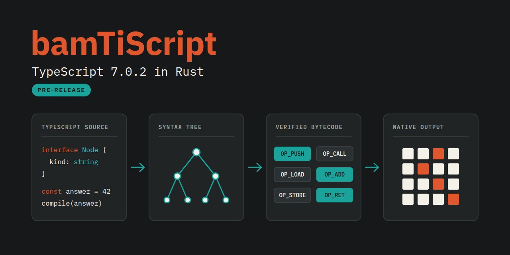

# bamTiScript



[](.github/workflows/ci.yml)
[](LICENSE)

bamTiScript is a pre-release clean-room TypeScript compiler and JavaScript runtime in Rust: it accepts the TypeScript 7.0.2 `tsc` argument model and, on Linux x64, compiles a source file to a native executable.

## Status

bamTiScript is for compiler and runtime developers evaluating an alternative TypeScript toolchain. It is not production software.

- Workspace version `0.2.0` is pre-release. No stable package or release tag exists while any gate in `.outline/GATES.md` is open (`CHANGELOG.md`).
- The working path today is a source build of the `bamts` CLI on Linux x64 (`docs/tutorials/quickstart.md`).
- `bamti` and `bamti-cli` `0.1.0` are published to npm, but their platform binary packages are absent from the registry, so an npm install cannot start the tool. The `0.2.0` package manifests in `npm/` are unpublished.
- TypeScript 7.0.2 is the compatibility oracle, not a completed compatibility claim. The project publishes no pass rate; diagnostic mapping is a classification, not a percentage (`docs/explanation/verification.md`).
- The formal completeness ledger currently records every Quint, Lean, and Redex catalog row as `BLOCKING_FAIL` (`docs/explanation/verification.md`).

## Example

```bash
cargo build --release -p bamts-cli   # writes target/release/bamts

target/release/bamts --noEmit --pretty false --ignoreConfig hello.ts   # type-check only
target/release/bamts --ignoreConfig hello.ts --outDir out              # writes ./out/hello
./out/hello
# hello from bamts
```

The `hello.ts` input is created in [Quick start](#quick-start).

## Why bamTiScript

- One `tsc`-compatible CLI: option names, `tsconfig.json`, `--project`, `--build`, response files, and exit-status classes match TypeScript 7.0.2 (`docs/reference/cli.md`).
- Direct source-file compilation emits a native host executable through `--outDir` instead of JavaScript (`docs/reference/cli.md`).
- Unsupported compiler options fail closed with `TS5047` and exit status 5 rather than being silently ignored (`docs/reference/cli.md`).
- The runtime stores ECMAScript strings as exact UTF-16 code units, including lone surrogates (`docs/explanation/architecture.md`).
- Interpreter, JIT, and AOT consume the same verified bytecode program (`docs/explanation/architecture.md`); execution-target selection is not a public CLI flag.
- The workspace defaults to `unsafe_code = "forbid"`, with documented exceptions in the codegen, native, FFI, and Node-API crates (`Cargo.toml`). This is a source policy, not an end-to-end memory-safety proof.

## Quick start

Requirements: Linux x64, Rust 1.97.1 or later (`rust-toolchain.toml`), Cargo, and a C compiler driver (`$CC`, default `cc`).

```bash
git clone https://github.com/gosuda/bamTiScript.git
cd bamTiScript
cargo build --release -p bamts-cli

cat > hello.ts <<'EOF'
const message: string = "hello from bamts";
process.stdout.write(`${message}\n`);
EOF

target/release/bamts --noEmit --pretty false --ignoreConfig hello.ts
target/release/bamts --ignoreConfig hello.ts --outDir out
./out/hello
```

Direct-file commands need `--ignoreConfig` here because the repository root
holds a `tsconfig.json`, which they otherwise refuse with `TS5112`.
The last command prints `hello from bamts`.

## Installation

The source build above is the only path that runs the current tree.

- `cargo install --locked bamts-cli` installs `bamts` from crates.io, currently version `0.1.0`, which is older than the `0.2.0` source.
- `npm install -g bamti-cli` installs the published `0.1.0` wrapper, but the platform packages it resolves (`bamti-cli-linux-x64` and the other four) are absent from the npm registry, so the CLI cannot start.
- `npm install bamti` installs the `0.1.0` in-process Node interface; its native addon packages are likewise absent. The `0.2.0` manifests in `npm/` are not published.

## Usage

```bash
bamts --help                       # help; --help --all prints every option
bamts --version                    # reports Version 7.0.2
bamts --init                       # write a recommended tsconfig.json
bamts app.ts --outDir out          # native executable at out/app
bamts --noEmit app.ts              # type-check only
bamts                              # compile the tsconfig.json in this directory
bamts --project ./tsconfig.json    # pick a configuration explicitly
bamts --build                      # build a composite project
```

Direct compilation writes `<outDir>/<entrypoint-name>`; with `--declaration` or `--sourceMap` (and emit enabled) the same path emits JavaScript artifacts instead of a native executable. One source file is limited to 16 MiB and a session to 256 MiB (`BAMTS-R001`, `BAMTS-R002`). The former `check`, `run`, `compile`, `explain`, `--target jit`, and `--target aot` forms are not public commands.

## Documentation

* [Quickstart guide](docs/tutorials/quickstart.md): step-by-step source build, type-check, and native executable emission.
* [CLI reference](docs/reference/cli.md): supported flags, project and build modes, exit codes, and resource budgets.
* [Diagnostics reference](docs/reference/diagnostics.md): diagnostic codes, output formats, UTF-16 column indexing, and error limits.
* [Architecture](docs/explanation/architecture.md): component boundaries, pipeline, string representation, and safety policy.
* [Verification](docs/explanation/verification.md): evidence model, conformance scope, and the limits of current claims.
* [Compiler rules](crates/bamts-compiler/RULES.md): diagnostic lint and strictness rule catalog.
* [UTF-16 string design](docs/solutions/architecture-patterns/exact-ecmascript-utf16-strings.md): the exact code-unit storage rules.
* [Release runbook](docs/release/runbook.md): the completion gates a stable release must pass.

## Contributing

See [CONTRIBUTING.md](CONTRIBUTING.md) for the pinned toolchain and the mandatory unpiped gates:

```bash
cargo fmt --all --check
cargo check
cargo clippy --workspace --all-targets -- -D warnings
cargo test --workspace
```

Every commit implements one logical change and must compile.

## License

Distributed under the [MIT License](LICENSE).
