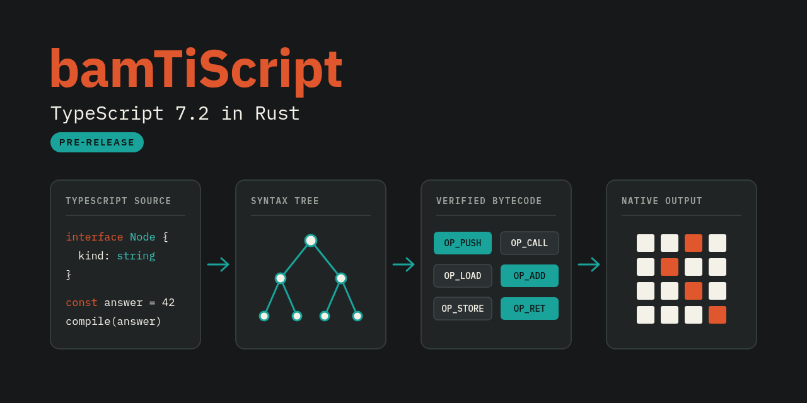

# bamTiScript



[](LICENSE)
[](Cargo.toml)
[](Cargo.toml)

bamTiScript is a pre-release Rust toolchain that type-checks and compiles TypeScript. TypeScript 7.0.2 compatibility is in progress.

## Naming conventions

- Repository: `bamTiScript`
- CLI binary: `bamts`
- Workspace crates: `bamts`, `bamts-cli`, `bamts-compiler`, `bamts-cancel`, `bamts-platform`, `bamts-bytecode`, `bamts-runtime`, `bamts-codegen`, `bamts-native`, `bamts-node`, `bamts-verification`, and private `bamts-napi`
- npm packages: `bamti` (in-process Node 24+ interface) and `bamti-cli` (standalone CLI transport). Currently published 0.1.0 packages on npm do not provide native binary artifacts; the source implementation of Node-API bindings is not yet published.

## Quickstart

Build the CLI from source, create a TypeScript entrypoint, type-check it, and emit a native host executable:

```bash
cargo build --release -p bamts-cli

cat > hello.ts <<'EOF'
const message: string = "hello from bamts";
process.stdout.write(`${message}\n`);
EOF

target/release/bamts --noEmit --pretty false hello.ts
target/release/bamts hello.ts --outDir out
./out/hello
```

## Project status

- Version `0.2.0` is pre-release.
- `bamti` provides an in-process Node 24+ interface backed by native Node-API bindings (`bamts-napi`) and atomic cancellation (`bamts-cancel`), while `bamti-cli` is the standalone CLI transport.
- The native addon design targets five host platform packages (`@bamti/bamti-linux-x64-gnu`, `@bamti/bamti-linux-arm64-gnu`, `@bamti/bamti-darwin-x64`, `@bamti/bamti-darwin-arm64`, `@bamti/bamti-win32-x64-msvc`) with fail-closed optional artifact loading.
- Currently published 0.1.0 npm packages do not contain prebuilt native binary artifacts. Real five-target release validation remains blocked by GitHub billing and is unverified. Build the working CLI from source with Cargo on Linux x64.
- The documented host runtime target is Linux x64. Direct `bamts <file> --outDir` compilation writes a native host executable; `--declaration` and `--sourceMap` on that path fail closed (`TS5047`).
## Current capabilities

- Type checking through the TypeScript-compatible `--noEmit` command line
- Native host executable output through `--outDir` on a direct source-file invocation (Linux x64)
- Project configuration and build mode through `tsconfig.json`, `--project`, and `--build`
- UTF-16 code-unit indexing for ECMAScript strings
- In-process Node.js 24+ interface via native Node-API bindings (`bamts-napi`) with atomic cancellation control (`bamts-cancel`)
- A limited Node-style host surface that includes `process.stdout.write`
## Explicit limitations

- TypeScript 7.0.2 is the compatibility oracle and target, not a completed compatibility claim.
- The public CLI follows the TypeScript 7.0.2 `tsc` argument model. The previous `check`, `run`, `compile`, `explain`, `--target jit`, and `--target aot` forms are not public CLI commands.
- `bamti` requires Node.js 24 or later. Currently published `0.1.0` npm packages do not contain compiled native artifacts; the source-tree native addon implementation is unpublished.
- `bamti` optional native package loading is fail-closed. Real five-target runtime release verification is blocked by GitHub billing and has not passed.
- The host runtime implements a limited Node-style API surface. It does not provide full Node.js compatibility.
- `--target jit` and `--target aot` are not public CLI flags. Direct compilation still emits a native host executable through `--outDir`; it does not emit JavaScript, declaration files, or source maps.
- The root workspace policy defaults to `unsafe_code = "forbid"`. Most crates inherit it. Native code generation, host export, verification, FFI, and private `bamts-napi` crates contain narrowly scoped, documented exceptions. This policy is not an end-to-end formal memory-safety guarantee.
- The project publishes no performance benchmark or production-readiness claim.
- Formal source artifacts target named properties. The current acceptance state is recorded in the proof ledger; complete compiler and runtime correctness is not proven.
## Documentation

* [Quickstart Guide](docs/tutorials/quickstart.md): Step-by-step source build, type-check, and native executable emission tutorial.
* [CLI Reference](docs/reference/cli.md): TypeScript-compatible command flags, project mode, build mode, and exit codes.
* [Diagnostics Reference](docs/reference/diagnostics.md): Diagnostic codes, output formats, UTF-16 column indexing, and error limits.
* [Architecture Explanation](docs/explanation/architecture.md): High-level system architecture and component boundaries.
* [Verification Explanation](docs/explanation/verification.md): Conformance testing, differential corpus, and formal verification models.
* [Compiler Rules](crates/bamts-compiler/RULES.md): Type checker invariants and diagnostic rules.
* [UTF-16 String Encoding Pattern](docs/solutions/architecture-patterns/exact-ecmascript-utf16-strings.md): UTF-16 string representation and runtime design.

## Contributing

See [CONTRIBUTING.md](CONTRIBUTING.md) for local environment setup (Rust 1.97.1, Edition 2024) and mandatory unpiped validation gates:

```bash
cargo fmt --all --check
cargo check
cargo clippy --workspace --all-targets -- -D warnings
cargo test --workspace
```

Every commit must implement one logical concern and compile cleanly.

## License

Distributed under the [MIT License](LICENSE).
